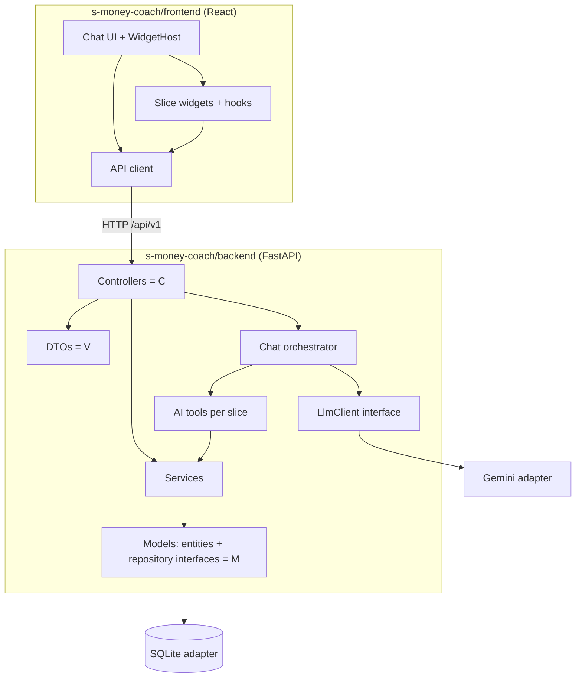
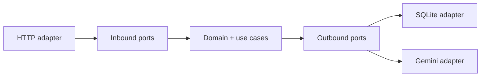
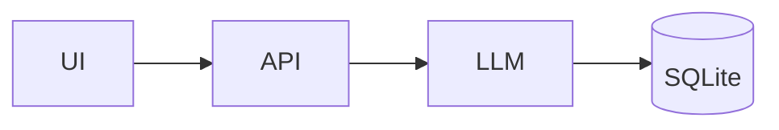
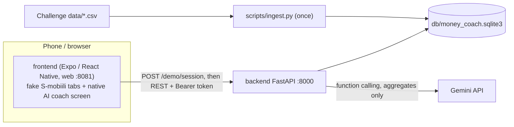

# Architecture

Status: DRAFT for approval.

## 1. Complexity assessment

| Driver | Level | Why |
|---|---|---|
| Features | medium | 3 feature areas, ~15 AI tools, 16 widget types |
| Data | low–medium | 3.6 M rows, but every query is for ONE customer (≤ 1,600 rows, checked) |
| Integrations | medium | Gemini (external), embedding in a host app |
| Team | medium | 3 workers in parallel, must not collide |
| Risk | high on trust | numbers must be exact; privacy under prompt injection |
| Time | very short | hackathon (deadline UNKNOWN, assumed < 30 h) |

**Size: medium.** That justifies clear layers and contracts (for parallel work and testability) but
NOT microservices, message queues or a separate domain core.

## 2. Options

### Option A — MVC + services, slices as plug-ins (RECOMMENDED, your choice)

One FastAPI app. Controllers (C) are thin routers; Models (M) are entities + SQLite repositories;
Views (V) are the DTOs from `contracts/dto`. A **services** layer holds all maths and is called
both by controllers and by AI tools. Outbound things (DB, LLM) sit behind interfaces in
`contracts/interfaces`. Each slice owns its own controller, service folder, tools and widgets.

Dependencies point **down/inward**: controllers → services → model interfaces; adapters implement interfaces.

- **Pros:** familiar to students; little ceremony; one process; the same service answers REST and AI; slices never touch each other's files.
- **Cons:** services can grow large; MVC "views" are only DTOs (fine for an API).
- **Cost to build (estimate):** foundation 6 / 9 / 14 h, each slice 8 / 12 / 18 h for one worker (opt/likely/pess). Basis: counted endpoints + tools + widgets per slice × ~45 min each, plus tests; **not measured** — replace with real times after the first task.
- **What would make us change later:** several teams or apps needing the same rules → extract a domain core (Option B); real banking load → Postgres + caching.

### Option B — Hexagonal (ports & adapters with a pure domain core)

Same as A, but rules live in a framework-free `domain/` with use-case classes; FastAPI and SQLite
are only adapters.

- **Pros:** cleanest testability; easiest to swap frameworks.
- **Cons:** ~30 % more files and mapping code; slower for a 3-person hackathon; your team chose MVC.
- **Cost (estimate):** +2 / +4 / +6 h on top of A.
- **Change trigger:** if the product continues after Junction inside S-Bank.

### Option C — LLM text-to-SQL over the database (minimal backend)

The model writes SQL directly; the backend executes it and the frontend renders generic charts.

- **Pros:** fastest to a first answer.
- **Cons:** model can produce wrong maths or **another customer's data** (prompt injection); no stable widgets; weak pedagogy; judges call it "a ChatGPT wrapper".
- **Cost:** 3 / 5 / 8 h — but fails NFR-1 and NFR-2. **Rejected.**

## 3. Recommendation

**Option A.** A simpler option (C) is *not* enough because it breaks correctness and privacy, which
are the heart of "trusted coach". B gives more purity than a hackathon needs; our interfaces in
`contracts/interfaces` already give the key benefit (swap DB/LLM, fake them in tests) without
the extra domain layer. Decision record: `decisions/0003-mvc-backend-with-services.md`.

## 4. Runtime view

## 5. Chat turn (how the AI stays honest)

1. Controller verifies the token → customer_id.
2. Orchestrator loads the last 10 messages and the tool specs of all registered slices.
3. Gemini answers with tool calls (or `force_tool` for quick actions).
4. For each call: `AiTool.run(ctx, args)` → service → facts + widgets. customer_id comes from `ctx` only.
5. Facts (not widgets, not rows) go back to Gemini; max 4 rounds.
6. Gemini writes ≤ 120 words using only numbers present in facts.
7. Response = text + widgets (from tools) + suggestions + sources; saved to `messages`.

Sequence diagram: `docs/diagrams.md` § Chat turn.

## 6. Security architecture (approved in Phase 0)

| # | Measure | Where |
|---|---|---|
| 1 | Signed JWT (HS256, 60 min, `sub` = customer_id), fetched by the AI screen itself, kept in memory (never in a URL) | foundation: `api/security.py`, frontend `auth/token.ts` |
| 2 | LLM never writes SQL; only fixed tools; customer_id injected from token | `ai_tool.py` contract |
| 3 | LLM gets aggregates only | tool `facts` rule |
| 4 | AI only proposes; saving needs a user tap (REST call) | habits widgets |
| 5 | API key only in backend `.env` (gitignored, checked) | config |
| 6 | DTO validation, CORS = Expo web origin (`http://localhost:8081`), CSP `frame-ancestors 'none'` | `api/server.py` |
| 7 | Sources on every widget; disclaimer on coaching / product text | DTOs |
