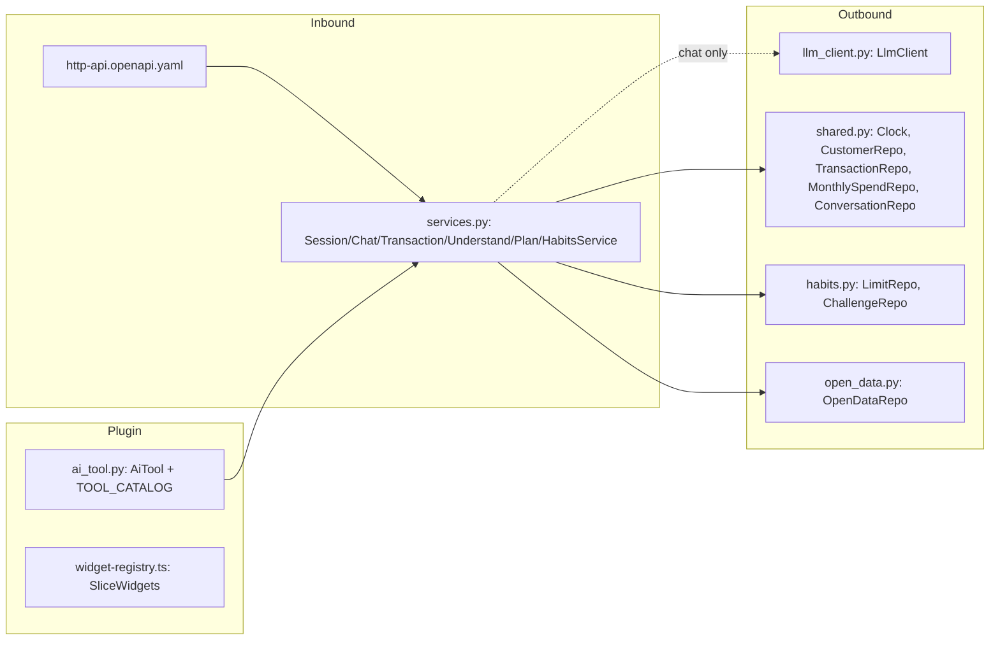

# Ports (interfaces)

Source of truth: `contracts/interfaces/`. **Inbound** = what the application offers.
**Outbound** = what it needs from outside. **Plug-in** = how a slice attaches to the foundation
without editing foundation files.

## Inbound ports

| Port | File | Implemented by (service) | Called by | Owner |
|---|---|---|---|---|
| HTTP API | `controllers/http-api.openapi.yaml` | controllers in `api/controllers/` | frontend, embedded-demo | per path `x-owner` |
| SessionService | `controllers/services.py` | `services/session_service.py` | session, health controllers; `security.py` | F |
| ChatService | idem | `services/chat/orchestrator.py` | chat_controller | F |
| TransactionService | idem | `services/transaction_service.py` | transactions_controller, `list_transactions` tool | F |
| UnderstandService | idem | `services/understand/service.py` | understand_controller, understand tools | W1 |
| PlanService | idem | `services/plan/service.py` | plan_controller, plan tools | W2 |
| HabitsService | idem | `services/habits/service.py` | habits_controller, habits tools | W3 |
| Errors | `controllers/errors.py` | foundation exception handler | every service raises them | F |

## Plug-in ports

| Port | File | Rule |
|---|---|---|
| AiTool / ToolContext / ToolResult | `llm/ai_tool.py` | Each slice exports `TOOLS` from `services/<slice>/tools.py`. Tool names must be from `TOOL_CATALOG`. Facts < ~1 KB, no customer_id. |
| SliceWidgets / WidgetProps / WidgetHostApi | `frontend/widget-registry.ts` | Each slice exports `widgets` from `src/slices/<slice>/index.ts`, only for its own widget types (dtos.md). Widgets call the API only through `api.request`. |

## Outbound ports

| Port | File | Adapter (implementation) | Used by | Owner of adapter |
|---|---|---|---|---|
| LlmClient | `llm/llm_client.py` | `adapters/llm/gemini_client.py` | ChatService only | F |
| Clock | `repositories/shared.py` | `models/repositories/clock.py` | all services | F |
| CustomerRepository | idem | `sqlite_customer_repo.py` | Session, Understand (peers) | F |
| TransactionRepository | idem | `sqlite_transaction_repo.py` | all slices | F |
| MonthlySpendRepository | idem | `sqlite_monthly_spend_repo.py` | all slices | F |
| ConversationRepository | idem | `sqlite_conversation_repo.py` | ChatService | F |
| LimitRepository, ChallengeRepository | `repositories/habits.py` | `sqlite_habits_repo.py` | HabitsService | W3 |
| OpenDataRepository | `repositories/open_data.py` | `open_data_repo.py` (JSON file) | UnderstandService | W1 |

Plan (W2) needs no private outbound port: it only reads shared repositories.

## Port ↔ service check

- Every inbound service has exactly one implementation file and one owner. ✔
- Every adapter sits behind a port above; no service imports SQLite or the Gemini SDK directly. ✔
- Every HTTP path's `x-owner` matches the service that answers it. ✔
- Every tool in `TOOL_CATALOG` maps to a service method and a widget type (dtos.md table). ✔

## Testing without the foundation

The foundation ships `tests/fakes/` with in-memory fakes of all shared ports and one fixture customer.
Until then, a slice can write its own temporary fakes against the Protocols in this folder, so
**W2 and W3 can start services and widgets the moment the contracts are approved.**
