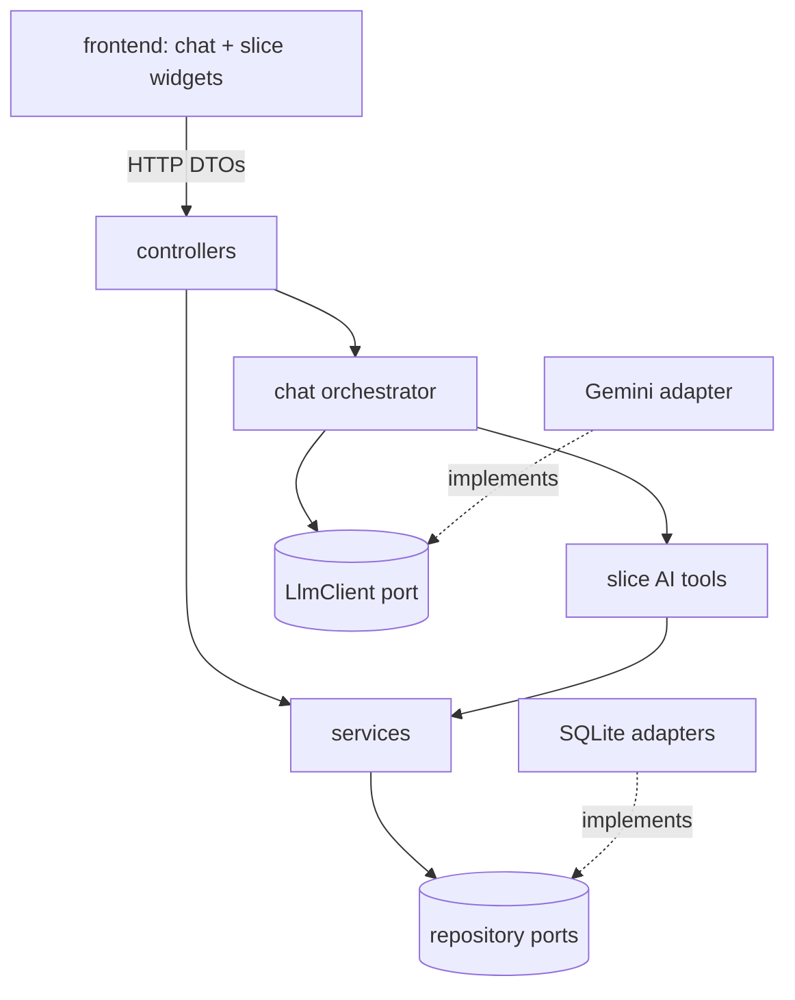
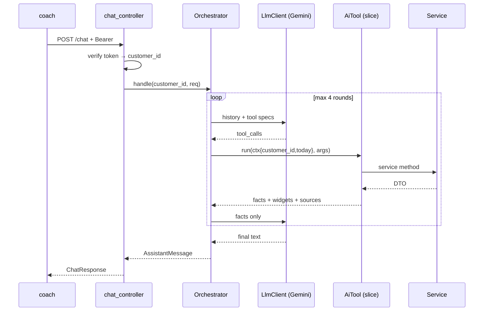

# Diagrams (index)

All diagrams are Mermaid, and each lives next to the text that explains it. This page lists them
and repeats the two most important ones.

| Diagram | Where |
|---|---|
| Embedding and runtime view | `architecture.md` §4 |
| Option A — MVC + services (chosen) | `architecture.md` §2 |
| Option B — Hexagonal | `architecture.md` §2 |
| Option C — Text-to-SQL (rejected) | `architecture.md` §2 |
| Use-case overview | `use-cases.md` |
| Global ER | `er.md` §1 |
| Ports map | `contracts/ports.md` |
| Build order of slices | `vertical-slices.md` |
| Sequence: foundation walking skeleton | `vertical-slices.md` Slice 0 |
| Sequence: Understand quick action | `vertical-slices.md` Slice 1 |
| Sequence: Plan what-if | `vertical-slices.md` Slice 2 |
| Sequence: Habits accept a limit | `vertical-slices.md` Slice 3 |

## Layers and dependency direction (chosen architecture)

## Chat turn

