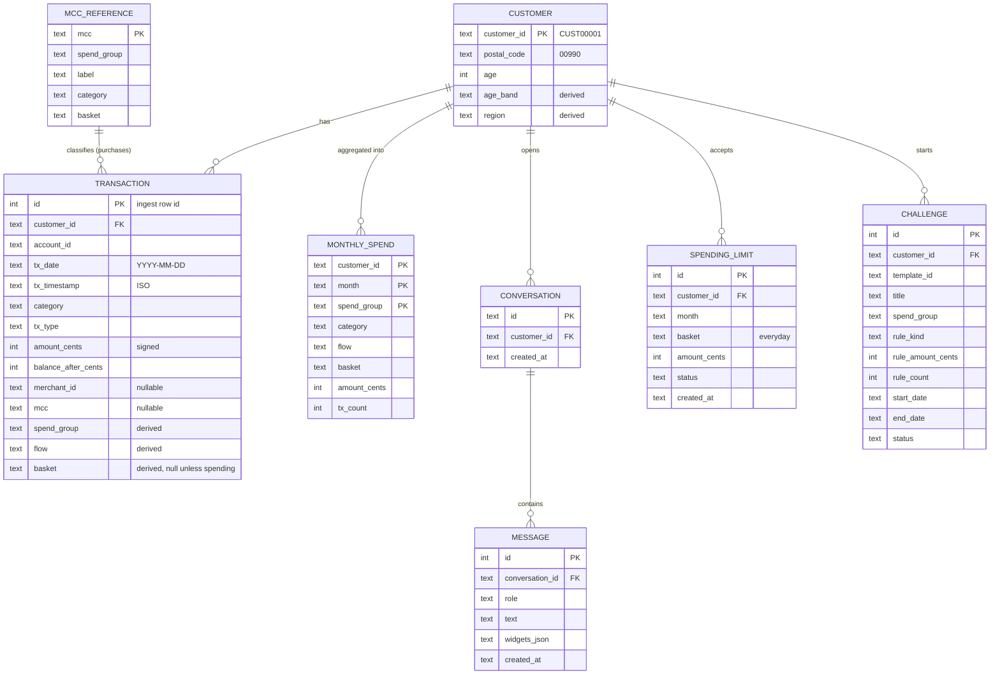

# Domain and data (ER)

Status: DRAFT for approval. Facts marked **checked** were measured on the dataset on 2026-11-14;
rules marked **ASSUMED** are our design choices and can be tuned (change = contract version bump
only if a DTO changes).

## 1. Global ER diagram

Plus `META(key PK, value)` for dataset range and default demo date (no relations).

## 2. Entities

| Entity | Persistent? | Owner (writes) | Table / where | In contract |
|---|---|---|---|---|
| Customer | yes (ingest) | foundation | `customers` | `Me`, `CustomerRecord` |
| Transaction | yes (ingest, read-only after) | foundation | `transactions` | `Transaction` |
| MccReference | yes (seed) | foundation | `mcc_reference` (from `db/seed/mcc_reference.csv`) | via `spend_group`/`label` fields |
| MonthlySpend | yes (ingest aggregate) | foundation | `monthly_spend` | `MonthlySpendRow` |
| Meta | yes | foundation | `meta` | `Me.data_from`, clock range |
| Conversation, Message | yes | foundation | `conversations`, `messages` | `ChatResponse`, `StoredMessage` |
| SpendingLimit | yes | habits (W3) | `spending_limits` (migration 0003) | `SpendingLimit`, `LimitRecord` |
| Challenge | yes | habits (W3) | `challenges` (migration 0003) | `Challenge`, `ChallengeRecord` |
| Session token | **no** (stateless JWT) | foundation | — | `SessionToken` |
| Demo clock | **no** (in memory, process-wide; resets to env on restart) | foundation | — | `DemoClock` |
| Basket breakdown, trend, spending summary, spender profile, peer benchmark | **no** (computed per request) | understand (W1) | — | understand.schema.json |
| Forecast, bill, income event, alert, safe-to-spend, what-if | **no** (computed) | plan (W2) | — | plan.schema.json |
| Limit suggestion, progress, review, challenge template, progress | **no** (computed; template ids are deterministic) | habits (W3) | — | habits.schema.json |
| Open-data reference | static file | understand (W1) | `db/seed/statfin_household_spending.json` | `OpenDataReference` |
| Mortgage data (`mtg_*.csv`) | **not used** | — | — | Reason: out of scope (requirements §6) |

## 3. Value objects and enums

| Value object / enum | Rule |
|---|---|
| `Cents` | integer; € × 100 rounded half-up at ingest. Spending shown to users is **positive** (`spent = −sum(amount_cents)` over spending rows). |
| `YearMonth` | `YYYY-MM`. |
| `Period` | `from_date ≤ to_date`, both inclusive, both ≤ today, both ≥ 2024-10-01. |
| `Percent` | 1 decimal; share = part / total × 100; total 0 → 0.0. |
| `Basket` | `mandatory_regular`, `mandatory_irregular`, `everyday`. |
| `Flow` | `income`, `spending`, `saving`, `transfer`. |
| `Category` | The 15 dataset categories (**checked**). |
| `SpendGroup` | 41 values (34 from MCC + 7 from tx_type), table §4. |
| `AgeBand` | 18-24, 25-34, 35-44, 45-54, 55-64, 65+ (ages 18–90 **checked**). |
| `HorizonDays` | 30, 60, 90. |

## 4. Classification rules (applied once at ingest)

### 4.1 Flow (by `transaction_type`, **checked**: 11 types)

| transaction_type | category | flow | spend_group | label |
|---|---|---|---|---|
| salary | Salary | income | salary | Salary |
| other_income | Other Income | income | other_income | Other income |
| investment_withdrawal | Invest Withdraw | income | investment_withdrawal | Investment withdrawal |
| investment_deposit | Invest Deposit | saving | investment_deposit | Investment deposit |
| salary_sweep | Salary Sweep | transfer | salary_sweep | Transfer to own account |
| housing_payment | Housing | spending | housing | Rent / housing |
| utilities_payment | Utilities | spending | utilities | Utilities |
| purchase | (8 categories) | spending | from MCC, §4.2 | from MCC |

### 4.2 MCC reference (all 36 MCCs found in the data, **checked**) — basket is **ASSUMED**

Basket logic: *mandatory_regular* = needed and predictable; *mandatory_irregular* = needed but
comes as a shock; *everyday* = choice, small and frequent, slips through fingers.

| MCC | spend_group | label | category | basket |
|---|---|---|---|---|
| — | housing | Rent / housing | Housing | mandatory_regular |
| — | utilities | Utilities | Utilities | mandatory_regular |
| 5411 | supermarkets | Supermarkets | Groceries | mandatory_regular |
| 5422 | butchers | Butchers | Groceries | mandatory_regular |
| 5451 | dairy | Dairy shops | Groceries | mandatory_regular |
| 4111 | public_transport | Public transport | Transportation | mandatory_regular |
| 5541 | fuel | Fuel | Transportation | mandatory_regular |
| 5542 | fuel | Fuel | Transportation | mandatory_regular |
| 5912 | pharmacy | Pharmacy | Health | mandatory_irregular |
| 8011 | doctors | Doctors | Health | mandatory_irregular |
| 8021 | dentists | Dentists | Health | mandatory_irregular |
| 8099 | health_services | Health services | Health | mandatory_irregular |
| 5200 | home_supplies | Home supplies | Home & Tech | mandatory_irregular |
| 5251 | hardware | Hardware | Home & Tech | mandatory_irregular |
| 5712 | furniture_appliances | Furniture & appliances | Home & Tech | mandatory_irregular |
| 5732 | electronics | Electronics | Home & Tech | mandatory_irregular |
| 5734 | software_apps | Software & apps | Home & Tech | everyday |
| 5499 | kiosks | Kiosks & convenience | Groceries | everyday |
| 5812 | restaurants | Restaurants | Restaurants | everyday |
| 5813 | bars | Bars | Restaurants | everyday |
| 5814 | fast_food_cafes | Fast food & cafés | Restaurants | everyday |
| 4121 | taxis | Taxis | Transportation | everyday |
| 7523 | parking | Parking | Transportation | everyday |
| 7832 | cinemas | Cinemas | Entertainment | everyday |
| 7922 | events_tickets | Events & tickets | Entertainment | everyday |
| 7991 | attractions | Attractions | Entertainment | everyday |
| 7996 | amusement_parks | Amusement parks | Entertainment | everyday |
| 7999 | recreation_sports | Recreation & sports | Entertainment | everyday |
| 5941 | sporting_goods | Sporting goods | Lifestyle | everyday |
| 5651 | clothing | Clothing | Lifestyle | everyday |
| 5691 | clothing | Clothing | Lifestyle | everyday |
| 5942 | books | Books | Lifestyle | everyday |
| 5945 | toys_hobbies | Toys & hobbies | Lifestyle | everyday |
| 5999 | other_retail | Other shops | Lifestyle | everyday |
| 4722 | travel_agencies | Travel agencies | Travel | everyday |
| 4511 | flights | Flights | Travel | everyday |
| 7011 | hotels | Hotels | Travel | everyday |
| 7512 | car_rental | Car rental | Travel | everyday |

A purchase with an unknown MCC → spend_group `other_retail`, basket `everyday` (none found, **checked**).
Note (**checked**): every purchase category has a few very large outliers (e.g. −18,031 € in
Entertainment). They stay in their basket and are surfaced by the Plan alert rule (§5.3).

### 4.3 Region and age band

- Region (**ASSUMED**, approximate): postal prefix `00` → "Helsinki", `01` → "Vantaa", `02` → "Espoo", else "Other". **Checked**: 2,557 / 1,116 / 1,427 customers; none outside 00–02.
- Age band from age (counts **checked**: 18-24: 419, 25-34: 658, 35-44: 1,616, 45-54: 1,756, 55-64: 376, 65+: 275).

## 5. Slice rules (owner implements; all **ASSUMED** thresholds, tune after a look at the data)

### 5.1 Understand (W1)
- **Breakdown:** spending rows of the month up to today; previous month cut at the same day-of-month when the month is partial.
- **Persona** on everyday rows of the last 90 days:
  `weekend_share` (Fri–Sun), `late_night_share` (21:00–04:59), `post_payday_share` (within 3 days after a salary date),
  `micro_spend` (rows < 15 €, monthly avg), `everyday_share` (everyday / all spending).
  First match wins: post_payday ≥ 25 % → `payday_splurger`; weekend ≥ 55 % → `weekend_socialiser`;
  micro rows ≥ 40 / month → `small_leaks`; everyday_share ≤ 25 % → `steady_planner`; else `balanced`.
  < 60 days of data → `balanced`. Forbidden words in texts: bad, irresponsible, waste, lazy, careless, failure.
- **Peers:** last 3 full months, per-customer monthly average for the scope/key; group = same age band and region; < 30 customers → all regions; percentile = % of peers with a lower value.

### 5.2 Plan (W2)
- **Payday:** day-of-month of the latest salary row; next payday = that day in the next month after today (clamped to month length). No salary in the last 45 days → today + 30, confidence low.
- **Bills:** for spend_group `housing` and `utilities`: if present in ≥ 2 of the last 3 full months → one bill per month on the median day, amount = median of the monthly totals; confidence high (3/3) or medium (2/3).
- **Daily rates (last 90 days):** essentials = non-bill mandatory_regular / 90; everyday = everyday / 90; irregular = mandatory_irregular over last 365 days / 365.
- **Forecast:** start = balance on today; each day subtract essentials + everyday + irregular; subtract bills on due dates; add expected salary (median of last 3) on paydays.
- **Safe-to-spend:** `safe_total = max(0, balance − bills before payday − essentials × days − irregular × days)`; per day = safe_total / days; this week = per day × min(7, days); status `over` if safe_total = 0, `tight` if per day < everyday daily rate, else `comfortable`.
- **Alert:** spending row in the period with |amount| ≥ 3 × median of the same customer's spend_group over 365 days, ≥ 50 €, group has ≥ 5 rows; severity `warning` at ≥ 6×.
- **What-if:** baseline monthly = avg of last 3 full months per target; adjusted = baseline × (1 + change_pct/100); forecast lines differ only by the daily delta; months_to_goal = goal / monthly_saving (null if ≤ 0).

### 5.3 Habits (W3)
- **Suggestion:** history = everyday spend of the last 3 full months; avg; suggested = floor to 10 € of avg × 0.9; min = 50 % avg, max = 120 % avg, step 10 €.
- **Accept:** only for the month of today; one active limit per month.
- **Progress:** on_pace = limit × days_elapsed / days_in_month; `over` if spent > limit; `at_risk` if spent > on_pace × 1.1; else `on_track`.
- **Review:** final numbers for the month (or so far); biggest leak = top everyday spend group; best week = 7-day window with the lowest everyday spend.
- **Experiments (challenges), decision 0015:** only the `everyday` basket. A group qualifies with ≥ 3 purchases in the last 28 days and ≥ 1 in the baseline week (the 7 full days before today); up to 3 groups, ordered by 28-day spend. Duration 7 days. Baseline = spend in the group in the 7 days before the start; target = floor(baseline × 0.5) in whole euros; no experiment when the baseline is 0. Template id = `max_amount_{spend_group}_7d`. Met when spent ≤ target; difference = baseline − spent; change_pct = (baseline − spent) / baseline × 100. Yearly figure = saving × 52, shown as an estimate. Won/lost decided when today ≥ end_date. Every finished experiment carries a plain-language concept note from the glossary.

## 6. Which story needs which entity

| Story | Entities |
|---|---|
| US-F1, US-F5 | Customer, Session token |
| US-F2, US-F3 | Conversation, Message (+ any slice result) |
| US-F4 | Transaction, MccReference |
| US-F6 | Demo clock, Meta |
| US-U1, US-U2, US-U4 | Transaction, MonthlySpend, MccReference |
| US-U3 | Transaction |
| US-U5 | MonthlySpend, Customer |
| US-U6 | Open-data reference |
| US-P1…US-P5 | Transaction, MonthlySpend |
| US-H1, US-H3, US-H4 | SpendingLimit, MonthlySpend, Transaction |
| US-H2 | SpendingLimit |
| US-H5 | Challenge, Transaction |
