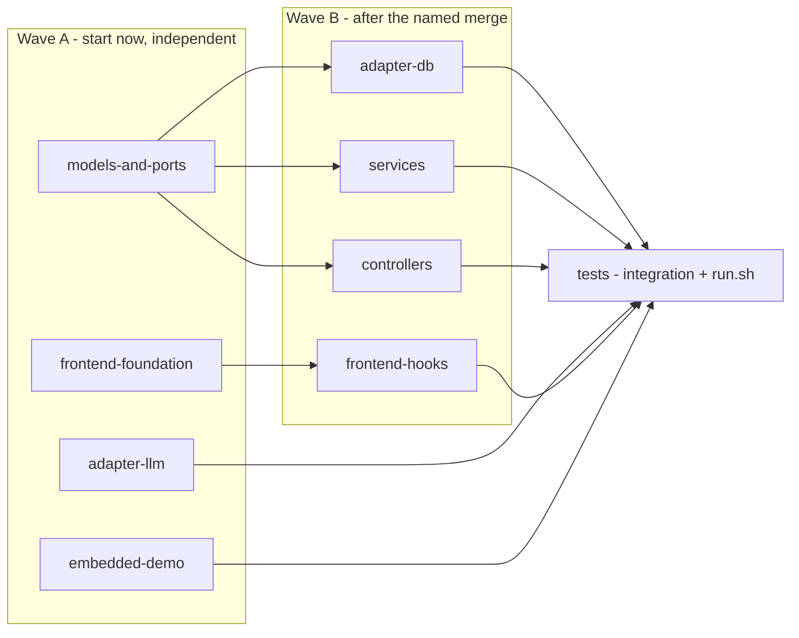

# Slice 0 — agent task board

Plan for building the foundation with several agents in parallel. One task = one branch = one git
worktree = one agent session. Branch names are the task names from `docs/vertical-slices.md`.
`foundation` is the **integration branch**: nobody develops on it, tasks are merged into it.

## Rules for every agent (read first)

1. Read only: this file, your task file, and the docs/contracts your task file lists. Do not explore the rest.
2. Edit **only** the files in your task's "Owns". Anything else → stop and write it in "Blockers" at the bottom of your task file.
3. `contracts/` is frozen. Never edit it. Never hand-edit generated code.
4. Work in small steps. After each step: run the task's check command, show its output, then commit (conventional commit, one per layer).
5. Never write "done" without the **Done when** command passing and its output shown.
6. Do not mock what you own. Fake only what you depend on (`backend/tests/fakes/`, `frontend/src/**/mocks.ts`).
7. Before finishing: `git fetch`-free rebase onto local `foundation` (`git rebase foundation`), rerun the check, tick the box in the table below (in your own branch only).
8. Stuck for 2 attempts on the same error → stop, write the error and what you tried in "Blockers". Do not loop.

## Layout decision

The repo uses root-level `backend/` and `frontend/` (not `s-money-coach/backend`, as `docs/filesystem.md`
says). **Keep the root-level layout; do not move anything.** Existing DB-foundation code
(`backend/models/dao/`, `backend/services/ingest_service.py`, `scripts/ingest.py`, `db/migrations/`) stays
and is adapted by `foundation-adapter-db`.

## Waves and dependencies



| Wave | Branch | Worktree dir | Needs merged first | Done |
|---|---|---|---|---|
| A | `foundation-models-and-ports` | `../Junction2026-models-and-ports` | — | [x] |
| A | `foundation-adapter-llm` | `../Junction2026-adapter-llm` | — | [x] |
| A | `foundation-frontend-foundation` | `../Junction2026-frontend-foundation` | — | [ ] |
| A | `foundation-embedded-demo` | `../Junction2026-embedded-demo` | — | [ ] |
| B | `foundation-adapter-db` | `../Junction2026-adapter-db` | models-and-ports | [ ] |
| B | `foundation-services` | `../Junction2026-services` | models-and-ports | [ ] |
| B | `foundation-controllers` | `../Junction2026-controllers` | models-and-ports | [ ] |
| B | `foundation-frontend-hooks` | `../Junction2026-frontend-hooks` | frontend-foundation | [ ] |
| C | `foundation-tests` | `../Junction2026-tests` | all of the above | [ ] |

Wave B worktrees are created by `scripts/spawn-wave.sh B` after the dependency is merged into `foundation`.

## Merging (done by the human or the coordinator, in the `foundation` worktree)

```bash
cd ../Junction2026-foundation
git merge --no-ff foundation-<task>      # then run that task's Done-when command on foundation
```

Review commit by commit (decision 0012).

## Shared definitions of done for the slice

`./run.sh` starts backend + coach + embedded-demo; AI tab → coach with 3 chips → "show my latest
transactions" → text + transaction_list widget with "See all"; chips answer "coming soon" (501);
`/dev/gallery` renders; 401 tests; ingest tests.
