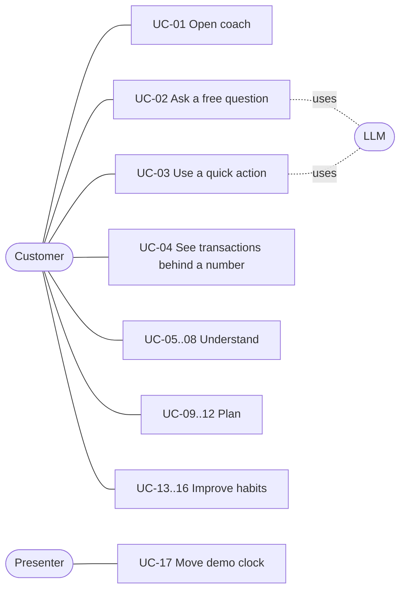

# Use cases

Actors: **Customer**, **Presenter** (pitch only), **LLM** (Gemini, external), **embedded-demo** (host app).
Every use case runs under a valid token; customer_id always comes from it.

| Id | Name | Actor | Main flow (short) | Errors | Stories | Slice |
|---|---|---|---|---|---|---|
| UC-01 | Open coach | Customer, embedded-demo | 1. Customer taps AI tab. 2. embedded-demo calls POST /demo/session for the persona. 3. Loads coach URL with `#token=…`. 4. Coach stores token in memory, calls GET /me, shows greeting + 3 chips. | Token missing/expired → "Please reopen from S-mobiili" screen. | US-F1, US-F5 | F |
| UC-02 | Ask a free question | Customer, LLM | 1. Customer types. 2. POST /chat. 3. Orchestrator sends question + tool list to LLM. 4. LLM calls 0–4 tools. 5. Tools return facts + widgets. 6. LLM writes text. 7. Coach renders text, widgets, suggestions, sources. | LLM down → 502 friendly message; bad tool args → error fed back to LLM once; off-topic → redirect text. | US-F2, US-F5, US-U2 | F |
| UC-03 | Use a quick action | Customer, LLM | As UC-02, but `quick_action` forces the first tool (`get_basket_breakdown`, `get_balance_forecast`, `suggest_monthly_limit`). | Same as UC-02. | US-F3 | F |
| UC-04 | See transactions behind a number | Customer | 1. Asks "show me those" or taps "See all". 2. `list_transactions` tool or GET /transactions with the widget's filter. 3. Paged list. | Empty result → "No transactions in this period". | US-F4 | F |
| UC-05 | See my three baskets | Customer | Breakdown for a month (default current) and trend over N months. | Month with no data → zero baskets, message. | US-U1, US-U4 | U |
| UC-06 | Ask spending on a thing | Customer, LLM | LLM maps words to basket/category/spend_group + dates ("taxis last month") → `get_spending`. | Ambiguous word → LLM asks one clarifying question. | US-U2 | U |
| UC-07 | Get my spender profile | Customer | `get_spender_profile` → persona card + tips. | Too little data (< 60 days) → "balanced" with note. | US-U3 | U |
| UC-08 | Compare with people like me | Customer | `compare_with_peers` for a basket or category → percentile vs peers (+ open data). | Peer group < 30 → widen to all cities, say so. | US-U5, US-U6 | U |
| UC-09 | Forecast my balance | Customer | `get_balance_forecast` (30 default); customer switches to 60/90 in the widget. | — | US-P1 | P |
| UC-10 | See bills and alerts | Customer | `get_upcoming_bills`, `get_expense_alerts`. | None found → positive message. | US-P4, US-P5 | P |
| UC-11 | Know what is safe to spend | Customer | `get_safe_to_spend` → per day / week until payday, with formula. | No salary detected → use 30-day cycle, say so. | US-P2 | P |
| UC-12 | Simulate a what-if | Customer | `simulate_what_if` (e.g. restaurants −20 %); slider re-calls POST /plan/what-if. | Invalid target → 400 → LLM rephrases. | US-P3 | P |
| UC-13 | Get and accept a monthly limit | Customer | `suggest_monthly_limit` → slider → "Accept" → POST /habits/limits. | Already active → 409 → show current progress instead. | US-H1, US-H2 | H |
| UC-14 | Track my limit | Customer | `get_limit_progress` → progress card. | No active limit → offer UC-13. | US-H3 | H |
| UC-15 | Review my month | Customer, LLM | `review_limit` → numbers; LLM writes feedback. | — | US-H4 | H |
| UC-16 | Do a challenge | Customer | `suggest_challenges` → "Start" → POST /habits/challenges → `get_challenge_progress`. | Same challenge active → 409. | US-H5 | H |
| UC-17 | Move the demo clock | Presenter | PUT /demo/clock (hidden control in embedded-demo). | Out of range → 400. | US-F6 | F |

Coverage: every story US-F1…US-H5 appears in the "Stories" column at least once.
