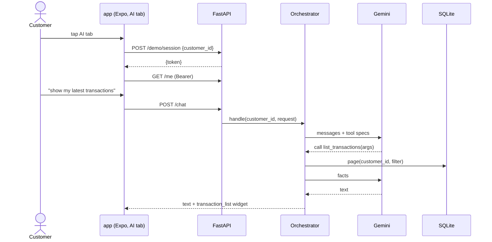
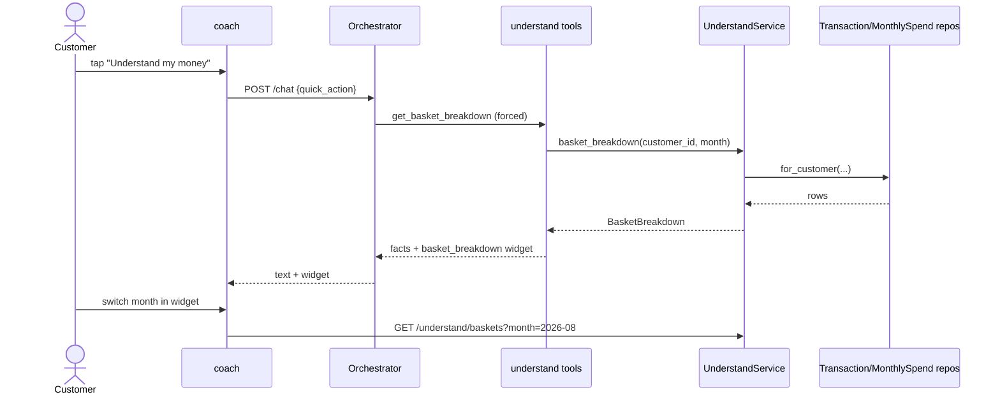
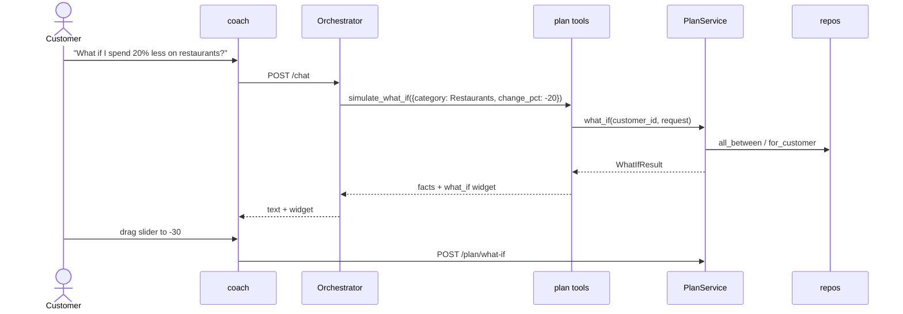
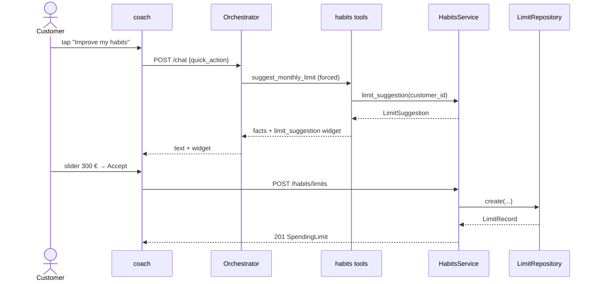

# Vertical slices

Status: DRAFT (Phase 5). Task **names and branches only**; details, owned files and estimates come
in `docs/slices-orchestration.md` (Phase 6, after the Phase 1 questions about machines and models).

Build order: **Slice 0 (foundation)** → Slices 1, 2, 3 **in parallel**, one worker each.
Thanks to the frozen contracts, slice services (against port fakes) and slice widgets (against
mocks in `/dev/gallery`) can start **while** the foundation is being built; only wiring and
integration tests wait for the foundation merge.

```mermaid
flowchart LR
  C[contracts + docs<br/>branch docs/plan] --> F[Slice 0 Foundation<br/>branch foundation]
  C -. services + UI with fakes/mocks .-> U[Slice 1 Understand · W1]
  C -. .-> P[Slice 2 Plan · W2]
  C -. .-> H[Slice 3 Habits · W3]
  F --> U
  F --> P
  F --> H
  U --> M[main · demo]
  P --> M
  H --> M
```

---

## Slice 0 — Foundation (walking skeleton)

- **Goal:** the thinnest end-to-end path: app → coach → chat → LLM → one tool → widget, on real data.
- **After it I can:** open the AI tab, see the coach with three chips, ask "show my latest transactions" and get a text answer plus a transaction list with "See all". The three chips answer "coming soon" (501 stubs).
- **Stories:** US-F1, US-F2, US-F3 (wiring), US-F4, US-F5, US-F6.
- **Started with one command:** `./run.sh` (backend + the Expo app); `python scripts/ingest.py` once before.
- **Done when:** ingest builds the DB with the rules in er.md §4 (tests on sample rows); token flow works (401 tests); the chat answers via Gemini with a transaction_list widget; slice stubs return 501; `/dev/gallery` renders; all foundation tests pass.



**ER view:** Customer, Transaction, MccReference, MonthlySpend, Meta, Conversation, Message.

**Tasks (one branch `foundation`, decision 0012):** foundation-adapter-db · foundation-adapter-llm ·
foundation-models-and-ports · foundation-services · foundation-controllers ·
foundation-frontend-foundation · foundation-frontend-hooks · foundation-tests

---

## Slice 1 — Understand my money (Worker 1)

- **Goal:** the three-basket "aha" moment, plus exact answers to "how much on X".
- **After it I can:** tap *Understand my money* → basket breakdown; ask "how much on taxis last month", "what kind of spender am I", "how do I compare"; switch month; see the trend.
- **Stories:** US-U1 … US-U6.
- **Done when:** the 5 understand endpoints and 5 tools pass their tests (sums equal SQL sums on the fixture customer); the 5 widgets are approved by you in the gallery and in chat.



**ER view:** Transaction, MonthlySpend, MccReference, Customer (peers), Open-data reference.

**Tasks:** understand-services · understand-adapter-db (open-data JSON, optional) · understand-controllers (controller + tools) ·
understand-frontend-ui · understand-frontend-hooks · understand-tests
**Parallel inside the slice:** services ∥ frontend-ui (mocks); then controllers ∥ frontend-hooks; then tests.

---

## Slice 2 — Plan my finances (Worker 2)

- **Goal:** look forward: forecast, safe-to-spend, what-if.
- **After it I can:** tap *Plan my finances* → 30-day forecast; switch to 60/90; ask "what is safe to spend this week", "what if I spend 20 % less on restaurants" and move the slider; see bills and alerts.
- **Stories:** US-P1 … US-P5.
- **Done when:** the 5 plan endpoints and 5 tools pass their tests (safe-to-spend steps add up; forecast has horizon+1 points; what-if with 0 % equals the baseline); the 5 widgets are approved by you.



**ER view:** Transaction, MonthlySpend (read only).

**Tasks:** plan-services · plan-controllers (controller + tools) · plan-frontend-ui · plan-frontend-hooks · plan-tests
**Parallel inside the slice:** services ∥ frontend-ui; then controllers ∥ frontend-hooks; then tests.

---

## Slice 3 — Improve my habits (Worker 3)

- **Goal:** turn insight into action: limits and challenges, tracked automatically.
- **After it I can:** tap *Improve my habits* → suggested limit; adjust it and tap Accept; ask "how am I doing"; jump the demo clock to month end and get a review; start a challenge and see its progress card.
- **Stories:** US-H1 … US-H5.
- **Done when:** migration 0003 applies cleanly; the 7 habits endpoints and 5 tools pass their tests (409 on double accept; 404 for another customer's limit); the 5 widgets are approved by you.



**ER view:** SpendingLimit, Challenge (owned), Transaction, MonthlySpend (read).

**Tasks:** habits-adapter-db (migration + repo + entities) · habits-services · habits-controllers (controller + tools) ·
habits-frontend-ui · habits-frontend-hooks · habits-tests
**Parallel inside the slice:** adapter-db ∥ services ∥ frontend-ui; then controllers ∥ frontend-hooks; then tests.

---

## Foundation-only work (no feature by itself)

Project setup (uv, Vite, scripts), DB + ingest, contract codegen, logging with request id, security
base (JWT, CORS, CSP), error handler, test fakes, run scripts. All inside Slice 0.

## Open point

Which worker builds the foundation is UNKNOWN. The plan assumes **Worker 1** (foundation, then
Understand). Understand is the most "visible" slice for the pitch, so if Worker 1 runs late, the
others should help with understand-frontend-ui at the end.
